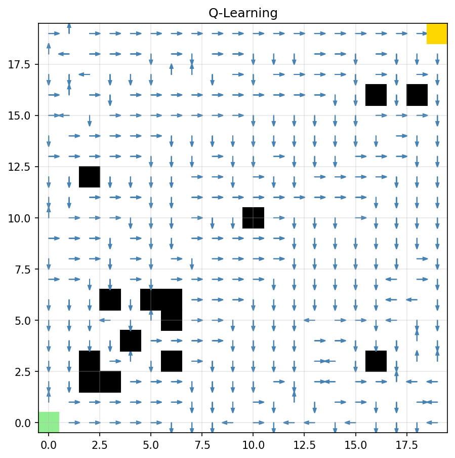
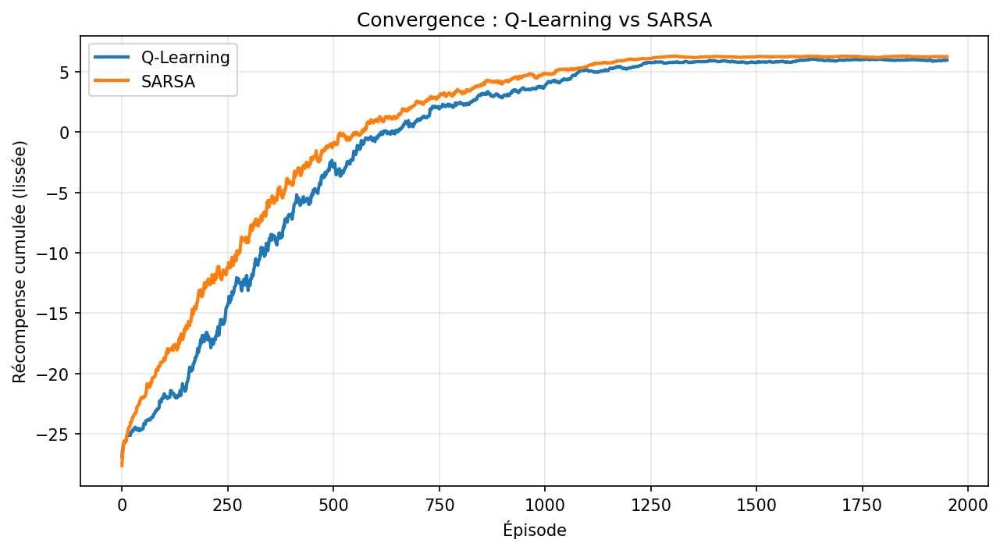

# Q-Learning vs SARSA — Navigation d'un agent dans un GridWorld

> Implémentation **from scratch** de deux algorithmes de Reinforcement Learning 
> (Q-Learning et SARSA) appliqués à la navigation d'un agent dans un 
> environnement encombré.

**Stack** : Python 3.10+ · NumPy · Matplotlib · imageio · tqdm · MIT License

---

## Objectif

Après un cours de Reinforcement Learning (théorie des MDP, équations de Bellman, 
TD-learning), ce projet passe **de la théorie à la pratique** en implémentant 
deux algorithmes classiques **sans bibliothèque RL** :

- **Q-Learning** (off-policy)
- **SARSA** (on-policy)

L'objectif : comparer leurs comportements, leurs convergences et leurs 
politiques apprises sur un problème de navigation robotique.

---

## Aperçu

| Q-Learning | SARSA |
|:---:|:---:|
|  |  |

| Courbe d'apprentissage |
|:---:|
|  |

**GIF** :
- `agent_ql.gif` — agent suivant la politique Q-Learning
- `agent_sa.gif` — agent suivant la politique SARSA

---

##  Formules clés

**Mise à jour Q-Learning (off-policy) :**

$$
Q(s,a) \leftarrow Q(s,a) + \alpha \left[ r + \gamma \max_{a'} Q(s',a') - Q(s,a) \right]
$$

**Mise à jour SARSA (on-policy) :**

$$
Q(s,a) \leftarrow Q(s,a) + \alpha \left[ r + \gamma \, Q(s',a') - Q(s,a) \right]
$$

**Politique ε-greedy :**

- Avec probabilité $1 - \varepsilon$ : choisir l'action $\arg\max_{a} Q(s,a)$
- Avec probabilité $\varepsilon$ : choisir une action aléatoire

**Décroissance de ε (forme fermée) :**

$$
\varepsilon_t = \max\left(\varepsilon_{\min}, \; \varepsilon_0 \cdot \lambda^t \right)
$$

**Implémentation récursive (équivalente) :**

$$
\varepsilon_{t+1} = \max\left(\varepsilon_{\min}, \; \varepsilon_t \cdot \lambda \right)
$$

---

##  Concepts couverts

| Concept | Fichier |
|---|---|
| Processus de Décision Markovien (MDP) | `env.py` |
| Équations de Bellman | `agents.py` |
| Politique ε-greedy | `agents.py` |
| TD-Learning (TD(0)) | `agents.py` |
| Q-Learning (off-policy) | `agents.py` |
| SARSA (on-policy) | `agents.py` |
| Visualisation de politique | `visualize.py` |

---

## 📁 Structure du projet

rl/
├── env.py # Environnement GridWorld (MDP)
├── agents.py # Q-Learning + SARSA
├── train.py # Boucle d'entraînement
├── visualize.py # Politique + GIF
├── compare.py # Comparaison 30 runs
├── main.py # Script principal
├── requirements.txt
├── README.md
├── learning_curve.png
├── policy_ql.png
├── policy_sa.png
├── agent_sa.gif
└── agent_ql.gif